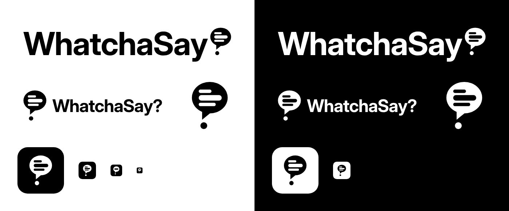

# WhatchaSay? — логотип

Чёрно-белый логотип расширения-компаньона для просмотра кино в оригинале.



## Идея знака

Знак — это буквально «What… say?»:

- **Облачко реплики** — то, что сказал персонаж (*say*).
- **Облачко + точка под хвостиком = «?»** — тот самый вопрос «чё он сказал?» (*whatcha…?*).
- **Строки внутри** — субтитры в духе караоке Apple Music: центральная активная реплика жирнее и длиннее, прошлая и будущая — тоньше и приглушены.
- Облачко над строкой — это и карточка-подсказка, которая всплывает прямо над непонятной фразой.

В вордмарке знак сам играет роль вопросительного знака в конце названия.

## Файлы

| Файл | Назначение |
| --- | --- |
| `logo-wordmark-black.svg` / `-white.svg` | Основной логотип: «WhatchaSay» + знак вместо «?» |
| `logo-horizontal-black.svg` / `-white.svg` | Знак слева + полное название «WhatchaSay?» |
| `mark-black.svg` / `mark-white.svg` | Только знак, прозрачный фон (строки — настоящие вырезы) |
| `icon-black.svg` / `icon-white.svg` | Иконка приложения (скруглённый квадрат) |
| `icon-small.svg` | Упрощённая иконка (одна строка) для 16–32 px |
| `png/icon-{16,32,48,128}.png` | Готовые иконки для `manifest.json` расширения |

Надпись набрана Inter Display Bold и переведена в кривые — шрифт устанавливать не нужно.

```json
"icons": {
  "16": "png/icon-16.png",
  "32": "png/icon-32.png",
  "48": "png/icon-48.png",
  "128": "png/icon-128.png"
}
```
